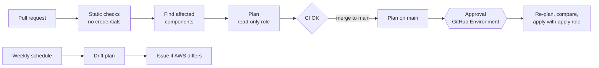

# CI/CD

One pipeline, one branch. `main` is the source of truth, accounts are separated by stack, and the same workflow serves a pull request and a merge. What differs is how far it goes: a pull request stops at the plan, a merge continues to an approved apply.

## The stages

Checks are ordered by cost and by trust. The cheap ones that need no credentials run first and on everything, including pull requests from forks. Anything that reaches AWS runs later and only for code from this repository.

| Stage | Job | Question it answers | Blocks a merge |
|-------|-----|---------------------|----------------|
| Static | `terraform fmt` | Is the code formatted the one standard way? | Yes |
| Static | `terraform validate` | Is the code consistent with itself and with the provider schema? | Yes |
| Static | `terraform test` | Does the logic this repo adds (validations, calculations) behave? | Yes |
| Static | `atmos validate stacks` | Do the stack files merge into valid configuration? | Yes |
| Static | TFLint | Are there mistakes `validate` cannot see, or conventions broken? | Yes |
| Static | Checkov | Is any resource configured insecurely? | Yes |
| Static | Gitleaks + account ID guard | Did a secret or an account ID get committed, now or ever? | Yes |
| Static | actionlint + zizmor | Is the pipeline itself correct and safe? | Yes |
| Plan | `plan` | What would this change do to AWS, and what would it cost? | Yes |
| Gate | `CI OK` | Did everything above pass? | It is the required check |
| Apply | `apply` | Apply exactly the plan that was approved | After merge |
| Scheduled | `drift` | Does AWS still match the code? | No, it opens an issue |

## What each tool is for, and what else exists

### Formatting, validation and tests

- **`terraform fmt -check`** ends style discussions: there is one format, and the machine enforces it.
- **`terraform validate`** catches references to things that do not exist, wrong types and arguments the provider does not have. It never calls AWS, so it cannot know whether a value is *valid in AWS*.
- **`terraform test`** runs the `.tftest.hcl` files with the AWS provider mocked. It is the unit-test layer: fast, free, no account. It tests this repo's logic, such as the overlap check in `ip-allocations`, and not AWS itself.
- **`atmos validate stacks`** checks the YAML layer that Terraform never sees.

Alternatives: Terratest (Go, creates real infrastructure: the integration layer, slow and not free), `tofu test` (the same idea in OpenTofu), LocalStack (emulated AWS for integration tests without an account).

### TFLint

A linter with provider knowledge. `validate` accepts `instance_type = "t3.superlarge"` because it is a string; the AWS ruleset knows that type does not exist. It also enforces conventions: typed and described variables, no unused declarations, naming.

A finding that is accepted is suppressed on the line, with the reason (`# tflint-ignore: rule`), never by turning the rule off for the whole repo.

Alternatives: none with the same provider awareness. Checkov and Trivy overlap only slightly; they look for insecure configuration, not incorrect configuration.

### Checkov

IaC security scanning: reads the Terraform and compares each resource with a catalog of known misconfigurations (unencrypted storage, open security groups, wildcard IAM). Findings also go to the repository's Security tab as SARIF, so they have a history.

Three different things get called "security scanning", and they do not replace each other:

| Kind | Looks at | Finds | Tools |
|------|----------|-------|-------|
| **IaC scanning** | Terraform, CloudFormation, Kubernetes manifests | Insecure infrastructure configuration | Checkov, Trivy (`config`), KICS, Terrascan |
| **SAST** | Application source code | Injection, unsafe functions, logic that leaks data | Semgrep, CodeQL, Bandit, SonarQube |
| **SCA** | Dependencies and container images | Known CVEs in what the code depends on | Trivy (`fs`, `image`), Grype, Dependabot alerts, `pip-audit`, `npm audit` |

This repo has only infrastructure code, so it needs the first. A project with an application needs all three.

A related tool that is *not* here on purpose: **Conftest / OPA**, which checks a plan against rules you write yourself ("every role must have a boundary", "no resource outside us-east-1"). Checkov brings a general catalog; Conftest enforces your own. With one person and one set of SCPs, the organization's guardrails already do that job.

### Gitleaks and the account ID guard

Gitleaks searches the whole Git history for credentials. History matters: deleting a secret in a later commit does not remove it from the repository.

Gitleaks does not consider an AWS account ID a secret, and it is right. But this repository is public and keeps its account IDs in `.env`, so a second step fails the build on any 12-digit number that is not the documented placeholder.

Alternatives: TruffleHog (can verify whether a found credential is live), GitHub secret scanning with push protection (blocks the push itself; free on public repositories, and it complements a CI check rather than replacing it), detect-secrets.

### actionlint and zizmor

The pipeline is code that holds credentials, so it gets linted like the rest.

- **actionlint** answers "is it correct?": YAML structure, expression syntax, shell errors in `run` blocks.
- **zizmor** answers "is it safe?": actions referenced by a tag that can be moved, untrusted input interpolated into a shell, tokens with more permissions than the job needs.

Alternatives: OpenSSF Scorecard (scores the whole repository's supply-chain posture), StepSecurity Harden-Runner (watches what a job actually does at run time).

### Plan

The plan is the review artifact: the diff between the code and AWS. Three things make it trustworthy here.

1. **Only affected components are planned.** `atmos describe affected` compares the stacks of the pull request with those of `main` and returns the components whose code or configuration changed. A change to the pipeline or to `atmos.yaml` plans everything.
2. **Only components marked for CI are planned.** A component runs in CI when its stack sets `settings.ci.enabled: true`. Everything else is run by a person.
3. **Nothing sensitive leaves the runner.** A binary plan contains state values in clear text, and artifacts of a public repository can be downloaded by anyone. The pipeline publishes only the text plan, with account IDs redacted.

Alternatives for running plans: Atlantis (self-hosted, plans and applies from pull request comments), Terrateam and Digger (the same idea on top of GitHub Actions), HCP Terraform, Spacelift, env0, Atmos Pro (managed, with policy and ordering built in). They add locking, ordering between components and a UI. For a handful of components, a workflow is enough.

### Cost estimate

OpenInfraQuote reads the plan and prices it from a public price sheet. No account, no API key, and it runs after the AWS credentials are removed from the job. It is informative: it never blocks.

| Tool | How it prices | Trade-off |
|------|---------------|-----------|
| **OpenInfraQuote** | Local price sheet, from the plan | No key, open source; fewer resource types covered |
| **Infracost** | Its Cloud Pricing API, from the code or plan | Widest coverage, diffs, policies; needs an API key |
| **AWS Pricing MCP server** | An AI assistant queries the AWS Price List | Good for exploring and for "what if" questions; not deterministic, so not a CI gate |
| **AWS Pricing Calculator** | Manual, or its API | The official numbers; nothing is automatic |

None of them sees usage-based cost (requests, data transfer, tokens). The estimate answers "what does it cost to exist", and the budget in this repo catches the rest.

### CI OK: the single required check

Branch protection requires one check, `CI OK`, which fails if any other job failed. Two reasons:

- Requiring jobs by name breaks every time a job is renamed or added. One stable name never does.
- A skipped job counts as passed. A plan that had nothing to plan must not block a documentation change.

### Apply

A merge to `main` plans again and, if the plan has changes, waits for approval on the GitHub Environment named after the stack. Merging and applying are two decisions.

After the approval, the job plans once more with the apply role and compares the text with the plan that was reviewed. If AWS or the state moved in between, it stops without applying. If they match, it applies that saved plan and nothing else.

A plan with no changes never asks for approval. An approval for nothing trains people to click without reading.

### Drift detection

A plan only runs when someone opens a pull request. A change made by hand in the console stays invisible until then, and then it shows up in someone else's unrelated plan. The scheduled workflow plans every CI-managed component each week and opens an issue when it finds a difference.

Alternatives: AWS Config (continuous, per-resource rules), CloudFormation drift detection (only for CloudFormation), driftctl (unmaintained), the drift features of Spacelift, env0 and HCP Terraform.

## How the pipeline reaches AWS

No access keys exist anywhere. GitHub signs a short-lived token for each job; AWS exchanges it for temporary credentials if the token's claims match a role's trust policy.

| Role | Trusts | Can do |
|------|--------|--------|
| `myownlandingzone-ci-plan` | Pull requests of this repo, and `main` | Read only |
| `myownlandingzone-ci-apply` | Jobs running in the `workloads` Environment | Read, plus write on exactly the resources CI manages |

- **Two roles, because a pull request runs unreviewed code.** A plan executes providers and data sources from the branch. If that job held write access, opening a pull request would be enough to change AWS.
- **The `sub` claim is the boundary.** Every repository on GitHub shares the same issuer, so the trust policy matches the exact subject, with no wildcards. This repository uses GitHub's immutable subjects, which carry the numeric owner and repository IDs, so a renamed or recreated repository cannot inherit the trust.
- **The apply role is assumable only from an Environment.** A job that references an Environment gets `environment:<name>` as its subject, and GitHub only issues that after the reviewers approve. The approval is enforced by AWS, not by the workflow file.
- **CI does not manage its own roles.** `ci-identity` is applied by a person. A pipeline that can edit its own role can grant itself anything, whatever its policy says today.
- **CI never touches `management`,** and today it only runs in `workloads`. There is no role for it anywhere else.

Fork pull requests and Dependabot receive no OIDC token and no secrets. Their runs stop at the static checks, which is the intended behaviour.

## Hardening of the pipeline itself

| Practice | Why |
|----------|-----|
| Actions pinned to a commit SHA | A tag can be moved to malicious code; a SHA cannot |
| Dependabot for actions and providers | Pins that nobody updates become their own risk |
| `permissions: {}` at the top, granted per job | A compromised step gets only what that job needed |
| `persist-credentials: false` on checkout | The repository token is not left on disk for later steps |
| Tool binaries verified by checksum | The download is what the release published |
| Untrusted values passed through `env`, never interpolated into scripts | A branch name cannot become shell code |
| Tool versions pinned in one composite action | The pipeline runs the same Terraform and Atmos as yesterday |

## Turning on the AWS jobs

The static checks work from the first push. Plan, apply and drift stay off until the roles exist:

1. Apply the roles, as a person: `atmos terraform apply ci-identity -s workloads`
2. Add the repository secret `NOTIFICATION_EMAIL` (the budget component needs it to plan).
3. Set the repository variable `CI_AWS_ENABLED` to `true`.

The account IDs are already repository secrets, and the `workloads` Environment already requires a reviewer.

## Adding a component to CI

1. Add a statement for what it manages to the apply policy in `ci-identity`, and apply that by hand.
2. Set `settings.ci.enabled: true` on the component in its stack.

In that order: the permission is reviewed and exists before the pipeline tries to use it.
